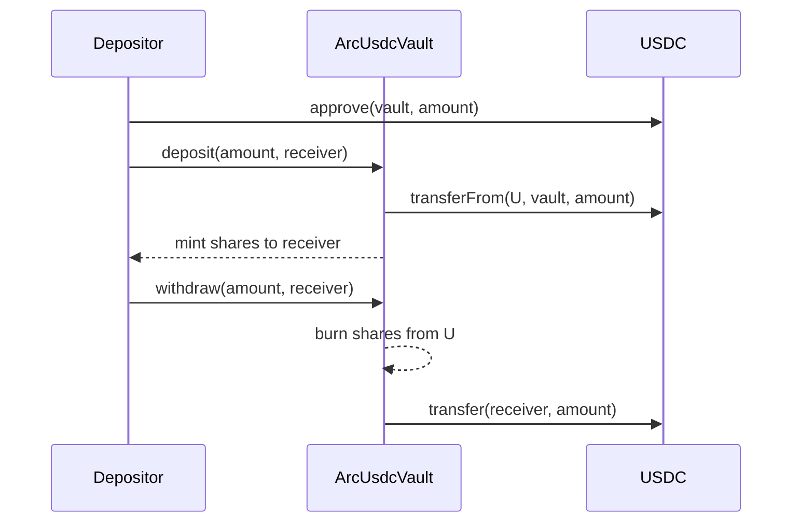

# ArcUsdcVault: Design Doc

## 1. Metadata

- Status: Draft (awaiting your confirmation)
- Target chain: Arc Testnet (chain ID 5042002). USDC ERC-20 view at the Arc USDC predeploy (passed in as a constructor argument, not hardcoded)
- Language / toolchain: Solidity ^0.8.24, Foundry, OpenZeppelin Contracts
- Reviews: [ ] Design  [ ] Security (automated + manual review before deploy)  [ ] Ops

## 2. Action Items (living)

_Empty. Filled after each review round._

## 3. Goals / Non-Goals

Goals
- Users deposit USDC and receive transferable ERC-20 receipt shares, 1 share = 1 USDC (both 6 decimals).
- Users burn shares to withdraw USDC at any time, even when the vault is paused.
- Admin controls are split into three roles with least privilege.
- Immutable: no proxy, no upgrade path.

Non-Goals
- No yield, strategies, fees, or lending of deposited funds. The vault never sends USDC anywhere except back to depositors.
- No upgradeability, no governance token, no off-chain signatures (no permit).
- No frontend in this scope.

## 4. Requirements

Functional
- F1 `deposit(amount, receiver)` pulls USDC from caller, mints `amount` shares to `receiver`.
- F2 `withdraw(amount, receiver)` burns `amount` caller shares, sends `amount` USDC to `receiver`.
- F3 Global deposit cap, adjustable by the cap manager.
- F4 Pause blocks deposits only. Withdrawals and share transfers keep working.
- F5 Admin can recover tokens sent by mistake, but never user-backed USDC.

Security (testable assertions)
- S1 `USDC.balanceOf(vault) >= totalSupply()` always.
- S2 No role can move user-backed USDC. Rescue can only move non-USDC tokens, or USDC above `totalSupply()`.
- S3 Only PAUSER can pause/unpause. Only CAP_MANAGER can change the cap. Only admin can grant/revoke roles and rescue.
- S4 `totalSupply() <= depositCap` after any deposit.
- S5 Withdraw works while paused.
- S6 Zero-amount and zero-address inputs revert.
- S7 Shares minted equal USDC actually received (balance-delta check).

## 5. Terminology & Actors

- Share: vault ERC-20 receipt token ("Arc USDC Vault Share", `vUSDC`, 6 decimals).
- Cap: maximum `totalSupply()` of shares; deposits that would exceed it revert.
- Surplus: `USDC.balanceOf(vault) - totalSupply()` (accidental direct transfers).

| Actor | On/off-chain | Trust | Can do |
| --- | --- | --- | --- |
| Depositor | onchain | untrusted | deposit, withdraw, transfer shares |
| Default admin | onchain | trusted (ideally multisig) | grant/revoke roles (two-step, delayed admin transfer), rescue |
| Pauser | onchain | semi-trusted | pause / unpause deposits |
| Cap manager | onchain | semi-trusted | set deposit cap |
| USDC token | onchain | trusted external | transfers; can blocklist addresses |

## 6. Language / Runtime

- Solidity ^0.8.24 (checked arithmetic). Foundry for build and test.
- Built on OpenZeppelin: `ERC20`, `AccessControlDefaultAdminRules`, `Pausable`, `ReentrancyGuard`, `SafeERC20`.
- No `unchecked` blocks.

## 7. Transaction & Execution Model

Each call is atomic. The only external calls are to the USDC token (`transferFrom` in deposit, `transfer` in withdraw/rescue). Discipline: checks, then effects (mint/burn), then interaction, and `nonReentrant` on deposit, withdraw, and rescue.

## 8. Chain Standards & Interfaces

- ERC-20 for the share token (decimals overridden to 6).
- USDC accessed only through its ERC-20 view (6 decimals). Native gas balance (18 decimals) is never read or used: the vault does not accept native value (no `receive`/`payable`).
- Not ERC-4626: 1:1 accounting without yield makes the extra surface unnecessary. This is a noted tradeoff (section 19).

## 9. Architecture Overview

| Step | Who moves what | Invariant |
| --- | --- | --- |
| Deposit | USDC user to vault, shares minted | received == minted; supply <= cap |
| Withdraw | shares burned, USDC vault to receiver | supply decreases by amount; balance >= supply |
| Rescue | non-USDC token or USDC surplus to recipient | balance >= supply afterwards |

Resting invariant: `USDC.balanceOf(vault) >= totalSupply()`.

Dependencies: Arc USDC (6 decimal ERC-20 view), OpenZeppelin. Assumption: USDC is a standard, non-rebasing, non-fee token. The balance-delta check enforces this at deposit time.

## 10. Contract Design

Roles

| Role | Holder at deploy | Permissions | Why |
| --- | --- | --- | --- |
| DEFAULT_ADMIN_ROLE | `admin` constructor arg | grant/revoke roles, rescue | Single top-level authority. Transfer is two-step with a delay (`AccessControlDefaultAdminRules`); cannot be renounced to zero in one step |
| PAUSER_ROLE | `pauser` arg | `pause`, `unpause` | Fast incident response, no other power |
| CAP_MANAGER_ROLE | `capManager` arg | `setDepositCap` | Risk limit control, cannot touch funds |

Storage

| Variable | Type | Notes |
| --- | --- | --- |
| `USDC` | `IERC20` immutable | Underlying token |
| `depositCap` | `uint256` | Max total shares, USDC units (6 decimals) |
| inherited | ERC20, Pausable, AccessControlDefaultAdminRules, ReentrancyGuard | |

Constructor: `(IERC20 usdc, address admin, uint48 adminDelay, address pauser, address capManager, uint256 initialCap)`. Reverts on zero addresses. A zero `initialCap` is allowed (deposits disabled until the cap manager raises it).

Writes

| Function | Caller | State | Events | Reverts |
| --- | --- | --- | --- | --- |
| `deposit(uint256 amount, address receiver)` | anyone | mints shares, pulls USDC | `Deposit(caller, receiver, amount)` | paused, amount 0, receiver 0, cap exceeded, received != amount |
| `withdraw(uint256 amount, address receiver)` | share holder | burns shares, sends USDC | `Withdraw(caller, receiver, amount)` | amount 0, receiver 0, insufficient shares |
| `pause()` / `unpause()` | PAUSER | pause flag | `Paused` / `Unpaused` | already in state |
| `setDepositCap(uint256 newCap)` | CAP_MANAGER | `depositCap` | `DepositCapUpdated(old, new)` | none (a cap below current supply simply blocks deposits) |
| `rescueToken(IERC20 token, address to, uint256 amount)` | admin | transfers token out | `TokenRescued(token, to, amount)` | to 0, amount 0, token is USDC and amount > surplus |

Reads: `depositCap()`, `maxDeposit()` (0 when paused, else remaining cap), `surplus()`, `decimals()` (6), `USDC()`.

## 11. Specification Tables (ERC-20 share token)

Principles: shares are standard ERC-20, freely transferable, 6 decimals, never minted except against received USDC, never burned except against a USDC payout.

| Functionality | Restriction | Event | Chain-specific adjustment |
| --- | --- | --- | --- |
| Share transfer | anyone, also while paused | `Transfer` | |
| Mint | only inside `deposit` | `Transfer(0x0, to, amt)` | |
| Burn | only inside `withdraw` | `Transfer(from, 0x0, amt)` | |

## 12. Deployment & Initialization

- Constructor-only init. No initializer, no proxy.
- Testnet runbook: deploy from the platform deployer wallet with `admin = deployer`, `pauser = deployer`, `capManager = deployer` unless you name other addresses. Then transfer each role to your real addresses and begin the two-step admin transfer.
- Constructor args are USDC address (from the Arc facts module), admin delay (default 1 day on testnet), and the initial cap.
- Funds left post-deploy: none; the vault starts with zero balance.

## 13. Upgradeability

None, by choice. Migration story: contract switch. Deploy a new vault, pause the old one, users withdraw and re-deposit. Integrators must re-point to the new address.

## 14. Key Management & Signing

No signatures or permits. Production guidance: admin on a multisig, pauser on a hot key or monitoring bot, cap manager on a separate operator key.

## 15. Security Considerations

| Vulnerability | Applicable? | Mitigation |
| --- | --- | --- |
| Reentrancy | Yes (USDC calls) | CEI plus `nonReentrant` on deposit, withdraw, rescue |
| Access control | Yes | Role-gated privileged functions, enumerated in section 10 |
| Integer overflow | Checked 0.8 | No `unchecked` |
| Unchecked external call | Yes | `SafeERC20` |
| Fee-on-transfer / rebasing | Mitigated | Balance-delta check at deposit reverts on mismatch |
| Donation / inflation attack | Not applicable | 1:1 shares, no price per share. Direct transfers only create surplus |
| Signature replay | N/A | No signatures |
| Front-running / MEV | Low | No price, only cap race (a deposit can fail if the cap fills; user just retries) |
| Oracle / flash loan | N/A | No oracle |
| Denial of service | Low | No loops, pull-based withdrawal |
| Delegatecall / proxy | N/A | Immutable |
| Timestamp dependence | N/A | Only the admin-delay timestamp from OZ |
| Approval persistence | Yes | Users approve exact amounts. Vault never holds approvals |
| Centralization | Yes | Admin cannot move user funds. Two-step delayed admin transfer. Multisig advised |
| USDC blocklist | Yes | `withdraw` takes a `receiver`, so a blocked caller can route to another address. A blocked vault address would freeze withdrawals (documented external risk) |
| Surplus rescue accounting | Yes | USDC rescue limited to `balance - totalSupply()` |

## 16. Trust Model & Threat Analysis

| Key | Worst case if compromised | Mitigation | Detection |
| --- | --- | --- | --- |
| Admin | Grant itself other roles, rescue non-USDC tokens and USDC surplus. Cannot take user-backed USDC | Multisig, admin transfer delay | `RoleGranted`, `TokenRescued` alerts |
| Pauser | Pause deposits indefinitely (withdrawals still work) | Admin can revoke and replace | `Paused` alert |
| Cap manager | Set cap to 0 (blocks deposits) or very high (loses a safety limit) | Admin can revoke | `DepositCapUpdated` alert |

## 17. Emergency Response

- Pause: PAUSER blocks new deposits. Withdrawals and share transfers continue.
- Playbook: pause, investigate, revoke compromised role via admin, unpause or migrate (section 13).
- Rescue: admin-only, restricted as in S2.

## 18. Failure Scenarios

- USDC `transferFrom` reverts (no allowance, blocklist): deposit reverts, nothing minted.
- USDC `transfer` reverts in withdraw (receiver blocklisted): whole call reverts, shares are not burned. Caller retries with another receiver.
- Someone sends USDC directly to the vault: surplus grows, no accounting change; admin may rescue it.
- Cap lowered under current supply: new deposits revert, existing users unaffected.

## 19. Priorities & Tradeoffs

| Decision | Tradeoff | Rejected alternative |
| --- | --- | --- |
| Custom 1:1 share token, not ERC-4626 | Less tooling compatibility, smaller surface, no inflation risk | ERC-4626 (needed only when share price floats) |
| Pause blocks deposits only | Admin cannot freeze users in | Full freeze (would let a compromised pauser lock funds) |
| Immutable | Fixes need a migration | UUPS proxy (adds upgrade key risk) |
| Admin holds rescue | One more admin power, bounded by surplus rule | Separate rescuer role (extra key to manage) |
| Delayed two-step admin handover | Slower key rotation | Plain `Ownable` |

## 20. Testing Strategy

- Foundry unit tests: deposit, withdraw, receiver routing, cap behavior, pause behavior (deposit blocked, withdraw OK), each role's permissions and unauthorized reverts, rescue limits, zero-value and zero-address reverts, admin two-step transfer, fee-on-transfer token rejection.
- Fuzz: deposit/withdraw sequences with random amounts and users.
- Invariants: `USDC.balanceOf(vault) >= totalSupply()`, `totalSupply() <= cap` unless cap lowered, supply equals sum of balances.
- Static analysis plus a manual security review before deploy.
- Command: `forge test -vv` from the project root.

## 21. Third-party Libraries

| Lib | Version | Already a dependency | Why |
| --- | --- | --- | --- |
| OpenZeppelin Contracts | installed version | Yes | Audited ERC20, access control, pausable, reentrancy guard, SafeERC20 |

## 22. Monitoring & Alerting

| Event | Severity | Action |
| --- | --- | --- |
| `Paused` | High | Notify operators, investigate |
| `RoleGranted` / `RoleRevoked` | High | Verify against change log |
| `TokenRescued` | High | Verify recipient |
| `DepositCapUpdated` | Medium | Verify against plan |

## 23. Stakeholders

Contract owner (you), security reviewer, and the operator holding each role.

## 26. Worked Example

Alice approves 100 USDC, calls `deposit(100e6, alice)`. The vault pulls 100e6 USDC, mints 100e6 shares to Alice, emits `Deposit`. Later `withdraw(40e6, bob)` burns 40e6 of Alice's shares and sends 40e6 USDC to Bob. Vault holds 60e6 USDC, supply is 60e6.

N/A sections: 24 (message encoding, no cross-chain) and 25 (no ABI-crossing structs or enums).
